# SOLARKITS – Delivery Manager Module Complete Implementation Plan
**Target User Role**: Delivery Manager / Warehouse Manager  
**Platform**: SOLARKITS Unified Admin Portal (`/warehouse-management-panel`) & Central Backend  
**Document Ref**: Development Requirement Document for Abhishek  

---

## 1. System Architecture & Workflow Overview

```mermaid
flowchart TD
    AM[Account Manager Confirms Order] -->|Forwards to Procurement| DO[Auto-Generated Delivery Order]
    DO --> MO_A[Module A: New Orders Tab\n/warehouse-management-panel/material-inward]
    
    subgraph Module_A [Module A: New Orders & Material Inward]
        MO_A --> BOS[View Order Card & Select BOS Kit Inventory Stock]
        BOS --> INW_BTN[Click 'Inward Material' on Card]
        INW_BTN --> INW_MODAL[Order-Specific Material Inward Modal]
        INW_MODAL --> CHK_QTY{All Items Inwarded 100%?}
        CHK_QTY -->|Partial Inward| PARTIAL[Status: Partially Inwarded\nStays in New Orders]
        CHK_QTY -->|Complete Inward| FULL[Status: Ready for Dispatch\nAuto-Moves to Out for Delivery]
    end

    FULL --> MO_B[Module B: Customer Outward / Out for Delivery\n/warehouse-management-panel/delivery-management]

    subgraph Module_B [Module B: Out for Delivery Station]
        MO_B --> METHOD{Select Delivery Method}
        METHOD -->|Manual Delivery| MAN_DTL[Enter Vehicle, Driver, Transporter & Docket]
        METHOD -->|Auto Delivery| AUTO_DTL[System-Assisted Vehicle & Driver Assignment]
        MAN_DTL --> EWAY[Request E-Way Bill from Account Manager]
        AUTO_DTL --> EWAY
        EWAY --> EWAY_VERIF[Account Manager Approves/Uploads E-Way Bill]
        EWAY_VERIF --> GATE_CHECK{Pre-Dispatch Verification}
        GATE_CHECK -->|1. Vehicle Rear Photo\n2. Delivery Docket/Challan\n3. Valid E-Way Bill| INITIATE[Activate 'Initiate Delivery']
        INITIATE -->|Order moves to Track Delivery| MO_C
    end

    subgraph Module_C [Module C: Track Delivery & POD Confirmation]
        MO_C[Module C: Trip Tracking & POD\n/warehouse-management-panel/delivery-management/tracking]
        MO_C --> TRACK_CARD[Delivery Tracking Card with Live Status Timeline]
        TRACK_CARD --> POD_CHOICE{Delivery Method}
        POD_CHOICE -->|Manual Delivery| MAN_POD[Upload Destination Delivery Proof Photo + Remarks]
        POD_CHOICE -->|Auto Delivery| AUTO_POD[Generate & Send Customer OTP -> Verify OTP]
        MAN_POD --> DELIVERED[Status: Delivered\nAudit Trail & Complete Dossier Saved]
        AUTO_POD --> DELIVERED
    end
```



---

## 2. Location-wise Module Mapping (As Per Your Instructions)

| Document Module | Existing Panel Location | Implementation Strategy |
| :--- | :--- | :--- |
| **Module A — New Orders & Material Inward** | `Material Inward` (`/warehouse-management-panel/material-inward`) | **Replace/Upgrade the inward screen tab** with a dedicated **"New Orders (BOS & Inward)"** tab containing delivery order cards, BOS Kit inventory reservation, filters (State, District, PIN, Date, Status), and the full Inward Material modal with quantity validation & auto-transition to Out for Delivery. |
| **Module B — Out for Delivery** | `Customer Outward (Delivery)` (`/warehouse-management-panel/delivery-management`) | Inside Customer Outward, add the **"Out for Delivery (Dispatch Prep)"** workflow: Select Manual/Auto Delivery, enter vehicle/driver/docket info, E-Way Bill request to Account Manager, 3-point dispatch gate checks (Vehicle Rear Photo + Docket + E-Way Bill), and "Initiate Delivery" button. |
| **Module C — Track Delivery** | `Trip Tracking & POD` (`/warehouse-management-panel/delivery-management/tracking`) | Inside Trip Tracking, display tracking cards with live order progress, vehicle & transporter details, and dual completion mechanics: **Manual Delivery Photo POD** vs. **Auto Delivery Customer OTP Verification**. |

---

## 3. Detailed Technical Blueprint

### Module A: New Orders & Material Inward (Inside `MaterialInward.jsx`)

#### 1. Delivery Order Card Components:
- **Card Header**:
  - Delivery Order ID (e.g. `DO-2026-0042`) and Linked Sales/Client Order ID (e.g. `SO-2026-0189`).
  - Order Priority Tag & Order Date.
  - Delivery Status Pill: `New Order`, `Partially Inwarded`, `Ready for Dispatch`.
- **Customer & Destination Info**:
  - Customer / Franchisee Name & Mobile.
  - Full Delivery Address with State, District, and PIN Code badges.
  - Required Vehicle / Recommended Transport Type (e.g., *Tata Ace / 14ft Eicher based on total kit weight*).
- **Ordered BOS Kit Products & Inventory Match**:
  - List of BOS items: Structure rails, GI fasteners, DC cables, ACDB/DCDB boxes, earthing rods, lightning arrestor, MC4 connectors.
  - Ordered Qty vs. Available Warehouse Stock vs. Pending Inward Qty.
  - Interactive **"Allocate / Reserve Inventory"** selector to lock inventory against this DO (preventing double allocation).
- **Filters Bar**:
  - State (Dropdown), District (Dynamic based on state), PIN Code search, Date Range Picker, Order Status filter (`All`, `New Orders`, `Partially Inwarded`).
- **Primary Action Button**:
  - `Inward Material` button directly on each card (colored vibrant primary blue).

#### 2. Order-Specific Material Inward Modal:
- Shows the DO ID, Client Name, and Warehouse Code.
- Itemized table with:
  - Product SKU & Name
  - Ordered Quantity
  - Already Inwarded / Received Quantity
  - Remaining Pending Quantity
  - **Inward Quantity Input** (Number input with strict validation: cannot exceed remaining pending quantity).
  - Storage Location / Rack Allocation input.
  - Remarks / Notes.
- **Inward History Sub-Table**:
  - Chronological history of all past inward batches for this order: Date, Time, User/Staff name, Quantity received, Remarks.
- **Automatic Status Transition Engine**:
  - If `Total Inwarded == Total Ordered`:
    - Status updates to `Ready for Dispatch`.
    - Automatically transfers the order from **New Orders** to **Out for Delivery** (`Customer Outward`).
    - Emits a real-time notification alert.
  - If `Total Inwarded < Total Ordered`:
    - Status updates to `Partially Inwarded`.
    - Order remains in **New Orders** with remaining pending quantity clearly flagged in amber.

---

### Module B: Out for Delivery Station (Inside `UnifiedCustomerOutward.jsx`)

#### 1. Order Selection & Dispatch Pipeline:
- Displays all orders in `Ready for Dispatch` status transferred from Module A.
- Tab/Step workflow for each order:

#### 2. Step 1: Select Delivery Method:
- Two distinct option cards:
  - **Manual Delivery**: Warehouse Manager arranges custom transport / local vehicle, enters details, and uploads physical dispatch evidence.
  - **Auto Delivery**: System recommends vehicle from master fleet based on total weight and handles OTP-based delivery.

#### 3. Step 2: Enter Delivery & Transport Details:
- Fields with auto-save & validation:
  - Vehicle Number (e.g., `MH 12 AB 1234`) & Vehicle Type (`3-Wheeler`, `Tata Ace 1.5T`, `14ft Eicher 4T`, `20ft Container`).
  - Transporter Name & Transporter ID / GSTIN.
  - Driver Name & Driver Mobile Number (10 digits).
  - Transport LR / Bilty Number.
  - Delivery Docket / Challan Number.
  - Dispatch Date & Expected Delivery Date/Time.
  - Recipient Destination & Customer Contact Phone.

#### 4. Step 3: Request E-Way Bill (Account Manager Integration):
- **"Request E-Way Bill" Action Button**:
  - Sends an instant request with invoice, client GST, delivery address, vehicle number, and distance to the Account Manager's pending queue.
  - Status updates to: `Awaiting E-Way Bill`.
- **Account Manager Response Card**:
  - Shows E-Way Bill Number (12 digits), Generated Date, Validity Period (e.g. Valid until *18/10/2026 23:59*), and Download/View E-Way Bill PDF.
- **Strict Dispatch Lock**:
  - The dispatch button is strictly disabled with a lock icon until a valid E-Way Bill is attached.

#### 5. Pre-Dispatch Evidence Verification Gate (Manual Delivery):
- Three mandatory verification checkpoints:
  1. **Loaded Vehicle Rear-Side Photo**: Upload photo clearly showing the vehicle registration plate and loaded BOS materials.
  2. **Signed Delivery Docket / Challan**: Upload scanned copy or photo of the delivery challan.
  3. **Verified E-Way Bill Document**: Valid E-Way Bill attached and verified.
- **"Initiate Delivery" Button**:
  - Disabled until all 3 documents are uploaded and valid.
  - Once clicked:
    - Status changes to `In Transit`.
    - Generates dispatch timestamp and audit log.
    - Moves order directly to **Track Delivery** (`Trip Tracking & POD`).

---

### Module C: Track Delivery & Delivery Confirmation (Inside `DeliveryTracking.jsx`)

#### 1. Tracking Cards & Dashboard:
- Filterable by: Active Dispatches (`In Transit`), `Delivered`, `Delivery Exception`.
- Information displayed:
  - DO ID, Client Name, Destination City & PIN.
  - Vehicle Number, Driver Contact (with one-click Call / WhatsApp link), Transporter Name.
  - Dispatch Date, Expected ETA, Days in Transit countdown.
  - View Documents: Delivery Docket PDF, Vehicle Loaded Photo, E-Way Bill PDF.
  - Visual 4-Stage Timeline:
    1. Order Inwarded & Verified
    2. Dispatch Initiated
    3. In Transit
    4. Destination Delivery Confirmation

#### 2. Manual Delivery Completion:
- Triggered by clicking **"Complete Manual Delivery"**:
  - Modal prompts delivery manager to upload:
    - Destination Delivery Proof Photo (materials unloaded at customer site).
    - Actual Delivery Date & Time.
    - Receiver Name & Signature / Remarks.
  - System checks that photo is attached -> Marks status as `Delivered`.

#### 3. Auto Delivery Completion (Customer OTP Verification):
- Triggered by clicking **"Verify Customer OTP"**:
  - **"Generate / Resend Delivery OTP"** button: Sends 6-digit OTP to customer's registered mobile number.
  - Delivery manager / driver inputs the 6-digit OTP.
  - Real-time backend validation:
    - Valid OTP -> Order marked as `Delivered`.
    - Invalid OTP -> Shows error alert, increments failed attempt counter, locks delivery if attempts exceed limit to prevent fraud.
  - Logs the verifying user ID, timestamp, and verification hash in the permanent audit trail.

---

## 4. Backend Models & API Endpoints

### 1. Delivery Order Schema (`DeliveryOrder.model.js` / Extended DB):
```javascript
{
  delivery_order_id: String,     // e.g. "DO-2026-0001"
  order_id: ObjectId,            // Ref to SalesOrder
  customer_id: ObjectId,
  customer_name: String,
  shipping_address: {
    address: String,
    state: String,
    district: String,
    pincode: String,
    phone: String
  },
  items: [
    {
      sku: String,
      product_name: String,
      category: String,          // 'bos_kit', 'panel', 'inverter'
      ordered_qty: Number,
      received_qty: Number,
      pending_qty: Number,
      reserved_inventory_id: ObjectId,
      rack_location: String
    }
  ],
  inward_history: [
    {
      batch_id: String,
      inwarded_qty: Number,
      inwarded_by: ObjectId,
      inwarded_by_name: String,
      timestamp: Date,
      remarks: String
    }
  ],
  delivery_status: {
    type: String,
    enum: [
      'confirmed_procurement',
      'new_order',
      'partially_inwarded',
      'ready_for_dispatch',
      'awaiting_eway_bill',
      'ready_to_initiate',
      'in_transit',
      'delivered',
      'delivery_exception'
    ],
    default: 'new_order'
  },
  delivery_method: { type: String, enum: ['manual', 'auto'], default: 'manual' },
  transport_details: {
    vehicle_number: String,
    vehicle_type: String,
    transporter_name: String,
    transporter_id: String,
    driver_name: String,
    driver_mobile: String,
    lr_number: String,
    docket_number: String,
    dispatch_date: Date,
    expected_delivery_date: Date
  },
  eway_bill: {
    requested: Boolean,
    requested_at: Date,
    requested_by: ObjectId,
    status: { type: String, enum: ['pending', 'approved', 'rejected'], default: 'pending' },
    eway_bill_number: String,
    valid_until: Date,
    eway_bill_pdf: String,
    verified_by: ObjectId
  },
  dispatch_evidence: {
    vehicle_rear_photo: String,
    docket_pdf: String,
    dispatched_at: Date,
    dispatched_by: ObjectId
  },
  delivery_completion: {
    completed_at: Date,
    completed_by: ObjectId,
    method: { type: String, enum: ['manual_photo', 'auto_otp'] },
    destination_photo: String,
    receiver_name: String,
    otp_code_hash: String,
    otp_verified_at: Date,
    remarks: String
  },
  audit_trail: [
    {
      action: String,
      performed_by: ObjectId,
      performed_by_name: String,
      timestamp: Date,
      notes: String
    }
  ]
}
```

### 2. New REST Endpoints in `warehouse.route.js`:
- `GET /warehouse-api/delivery-orders` -> List all delivery orders with filters (state, district, pincode, status, date).
- `GET /warehouse-api/delivery-orders/:id` -> Single delivery order details with inward history.
- `POST /warehouse-api/delivery-orders/:id/reserve-inventory` -> Reserve BOS Kit inventory items.
- `POST /warehouse-api/delivery-orders/:id/inward` -> Record itemized inward, validate remaining qty, update status to `ready_for_dispatch` if complete.
- `POST /warehouse-api/delivery-orders/:id/transport-details` -> Save vehicle, driver, transporter, and dates.
- `POST /warehouse-api/delivery-orders/:id/request-eway-bill` -> Notify Account Manager login.
- `POST /warehouse-api/delivery-orders/:id/initiate-dispatch` -> Verify loaded photo + docket + e-way bill and move to `in_transit`.
- `POST /warehouse-api/delivery-orders/:id/send-otp` -> Send delivery completion OTP to customer phone.
- `POST /warehouse-api/delivery-orders/:id/verify-otp` -> Verify OTP and complete delivery.
- `POST /warehouse-api/delivery-orders/:id/complete-manual` -> Complete delivery with destination photo & remarks.

---

## 5. UI/UX Plan & Aesthetics

1. **New Orders Tab in Material Inward**:
   - Modern glassmorphism card layout with distinct color-coded badges for order priorities and delivery statuses.
   - Live inventory status pill (e.g. *In Stock (Green)* vs *Shortage (Red)*).
   - Inward modal with smooth animations, clear numeric stepper inputs, and progress bars showing inward completion percentage.

2. **Customer Outward (Delivery) Station**:
   - Step-by-step dispatch workflow wizard: Method Selection -> Transport Details -> E-Way Bill Status -> Upload Checkpoints -> Dispatch.
   - Visual document upload cards with live thumbnail preview of loaded vehicle photo, delivery docket, and e-way bill.
   - Glowing "Initiate Delivery" button that only unlocks when all 3 required documents are verified.

3. **Track Delivery & POD**:
   - Timeline tracking visualizer with live route indicator.
   - Interactive OTP entry box with countdown resend timer.
   - High-resolution modal image preview for destination delivery photos.

---

## 6. Implementation Rollout Steps

1. **Step 1 (Backend Foundations)**:
   - Create/mount the Delivery Order schema, seed data, and controller handlers for inwarding, transport details, e-way bill request, OTP generation/validation, and POD confirmation.
2. **Step 2 (Material Inward – New Orders & Inward Modal)**:
   - Upgrade the tabs in `MaterialInward.jsx` to feature the "New Orders" module with DO cards, filters, and the interactive Material Inward modal.
3. **Step 3 (Customer Outward – Out for Delivery Station)**:
   - Implement the dispatch preparation screen in `UnifiedCustomerOutward.jsx` with Manual/Auto selection, transport details form, E-Way Bill request, and the 3-point dispatch gate checks.
4. **Step 4 (Trip Tracking & POD Confirmation)**:
   - Implement the tracking cards and completion modal (Manual Photo vs Auto OTP verification) in `DeliveryTracking.jsx`.
5. **Step 5 (End-to-End Verification)**:
   - Test complete flow: Order Confirmed -> New Orders -> Select BOS Inventory -> Inward Material (Partial then Complete) -> Auto-moves to Out for Delivery -> Enter Vehicle & Request E-Way Bill -> Upload Loaded Photo & Docket -> Initiate Dispatch -> Move to Track Delivery -> Confirm Delivery via Photo & OTP -> Verify audit trail.
